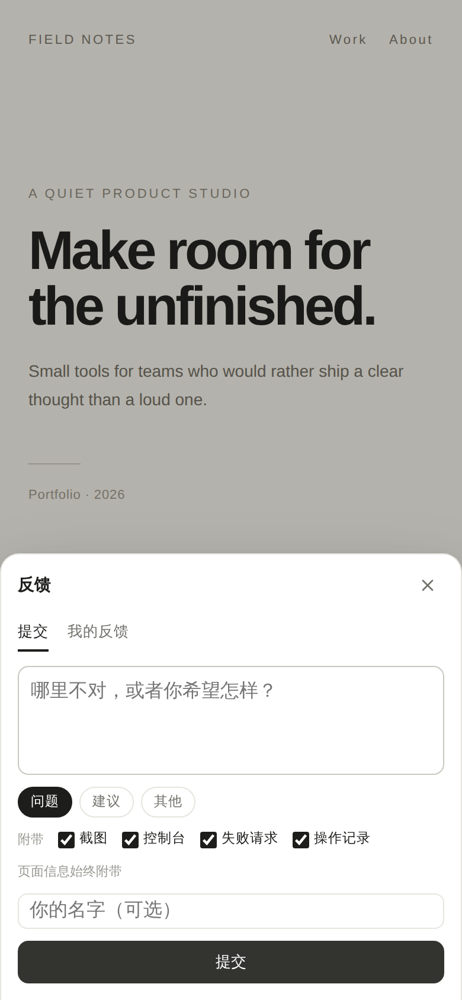

# mini-feedback

A self-hosted feedback inbox for web apps.

一个自托管的开发反馈收件箱。Web 页面加一行 script，右下角出现贴边胶囊；提交时自动截屏并带上控制台、失败请求、路由和操作记录。所有反馈汇成一张表，状态可推进，提交者能在挂件里看到进展。



## 特性

- **一行接入**：`<script>` 或书签脚本，Shadow DOM 隔离，不污染宿主样式。
- **可选现场**：截图、控制台、失败请求、操作记录默认勾选，提交前可取消；页面信息始终附带。
- **手机优先**：贴边半胶囊、全宽抽屉、无横向溢出；可拖动换边。
- **轻量**：Hono + SQLite + React；没有外部服务、队列或对象存储。
- **可追踪**：`open / doing / located / needs_info / done / wontfix` 六态，状态历史、截图、管理台筛选与 CSV。
- **机器可读**：Bearer token 的增量导出 API；服务本身不调用任何模型。

## 快速开始

### Docker

```bash
cp .env.example .env
# 填 MINI_FEEDBACK_PASSWORD / MINI_FEEDBACK_SECRET / API_TOKEN
docker compose up -d --build
```

打开 `http://localhost:52717`，用 `.env` 里的密码登录管理台。

### 本地开发

需要 Node.js 22.5+、pnpm。

```bash
pnpm install
cp .env.example .env
# 填 PORT / ADMIN_DEV_PORT / MINI_FEEDBACK_PASSWORD /
#    MINI_FEEDBACK_SECRET / API_TOKEN
pnpm dev
```

开发时管理台在 `ADMIN_DEV_PORT`，API 与挂件脚本在 `PORT`。生产构建：

```bash
pnpm build
pnpm start
```

生产模式下管理台、API 和 `/w.js` 都在 `PORT` 上。

## 配置

| 变量 | 必填 | 说明 |
| --- | --- | --- |
| `PORT` | 是 | 服务端口，例如 `52717` |
| `HOST` | 否 | 监听地址，默认 `0.0.0.0` |
| `DATA_DIR` | 否 | SQLite 与上传文件目录，默认 `./data` |
| `MINI_FEEDBACK_PASSWORD` | 是 | 管理台共享密码 |
| `MINI_FEEDBACK_SECRET` | 是 | 登录 Cookie 的 HMAC 密钥，建议 `openssl rand -hex 32` |
| `API_TOKEN` | 是 | 机器读写 API 的 Bearer token |
| `PUBLIC_BASE_URL` | 否 | 对外地址，用于生成截图绝对路径 |
| `ADMIN_DEV_PORT` | 否 | 仅 `pnpm dev` 时管理台 Vite 端口 |
| `ENV_FILE` | 否 | 从仓库外的 env 文件读取配置 |

## 接入

在布局里加：

```html
<script src="https://feedback.example.com/w.js" data-project="demo" defer></script>
```

可选属性：

- `data-theme="dark"`：深色宿主上使用浅色胶囊。
- `data-position="left"`：初始贴左；用户仍可拖动换边。
- `data-endpoint="https://feedback.example.com"`：脚本与 API 不同源时指定服务地址。

管理台「接入」页会按当前服务地址生成可复制脚本和书签脚本。

## 数据与 API

- SQLite：`data/mini-feedback.db`（WAL），截图在 `data/uploads/`。
- `GET /api/export?since=<epoch_ms>&limit=200`，带 `Authorization: Bearer $API_TOKEN`；返回 `{items, next_since}`，`items[].screenshot_path` 是服务端路径。
- `PATCH /api/feedback/:id`，同一个 token，可改状态、写说明和交付标记。
- 管理台右上角可导出 CSV。
- 服务不调用模型。需要自动分诊时，用任意 agent/脚本通过 API 轮询 `open` 并更新状态；具体 harness 不在本仓库内。

## 部署与安全

- 建议把 env 放在仓库外，用 `ENV_FILE` 指向；`data/` 与 `.env` 已在 `.gitignore` 中。
- 服务只应暴露在可信网络。公网部署时管理台必须走 HTTPS；提交端点按 IP 限流。
- 截图和控制台可能包含敏感信息；提交者可以在提交前取消对应附件。共享给他人前先检查数据目录。
- 备份：服务每日用 `VACUUM INTO` 在 `data/backups/` 生成快照，保留 14 份。

## 开发

```bash
pnpm typecheck
pnpm build
```

服务端是 `src/server`，管理台是 `src/admin`，挂件是 `src/widget`。构建产物：`dist/admin`、`dist/w.js`、`dist/snapdom.js`。

## License

MIT
